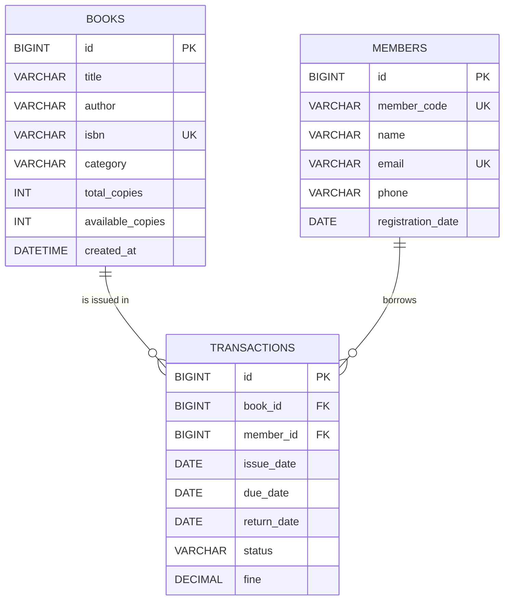

# Entity relationship diagram

A book or member can have many historical transactions. Each transaction references exactly one book and one member. `available_copies` is maintained by the service layer: it decreases on issue and increases on return. The foreign keys prevent orphaned transactions.
